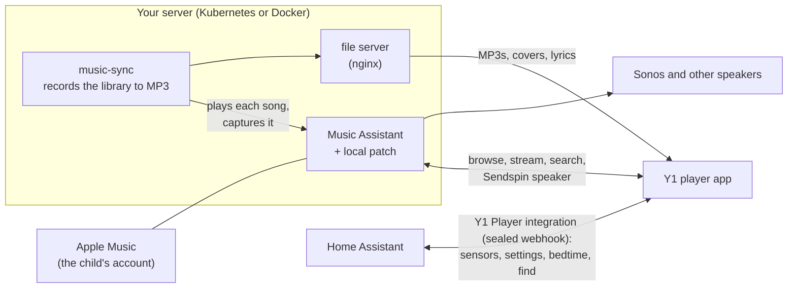

# sendspin-y1

Turns an [Innioasis Y1](https://www.innioasis.com/) (a cheap click-wheel music player running Android 4.2) into a
child's music and audiobook player, built on [Music Assistant](https://music-assistant.io/) and
[Home Assistant](https://www.home-assistant.io/).

It plays from its own storage with no network, streams anything else through Music Assistant, and keeps the parent in
charge: a shared bedtime listening budget, clean versions of explicit songs, a grown-up code, and a "find it" button in
Home Assistant.

## What it does

- **Click-wheel player:** the app is the home screen, drawn for the Y1's wheel: music by artist, album and genre, New
  songs, Favourites, audiobooks with chapters, synced lyrics, a cover flow, and a hold lock.
- **Offline first:** the child's whole Apple Music library is recorded to MP3 on a small server (`music-sync`) and synced
  to the player, with covers and lyrics. Audiobooks download from Music Assistant. Everything plays with no Wi-Fi.
- **Search and add:** search Apple Music from the wheel, stream a song or album, add it to the child's library (it then
  syncs to the player), or take a song off again (also out of their Apple Music library).
- **Voice search:** hold the centre button (anywhere but on a song, where holding favourites it), say what you want,
  let go. Playback pauses while it listens, a live waveform shows it hearing you, and the results list songs on the
  player first, then what can be streamed. Speech becomes text through Home Assistant's speech-to-text on Wi-Fi, or on
  the player itself with whisper.cpp (`java/android/native/stt/build.sh install`, 3 to 5 s) when offline or when
  "Voice on the iPod only" is on.
- **Help video and gifting:** the last row of the menu plays `/sdcard/Help/help.mp4`, listing its chapters (names and
  start times from `help.json` beside it) so you can start anywhere; it carries on through the rest. "Armed for
  gifting" (a switch on the Home Assistant device, or a grown-up row in Settings) locks the player so the first three-tap
  unlock plays the video at full volume, then disarms: ready to hand over and explain itself. `deploy/help/make_stub.py
  push` makes and installs a placeholder video; the real one replaces the two files.
- **Any speaker:** "Listen on" moves playback between the player (speaker or Bluetooth headphones) and any Music Assistant
  speaker, keeping the place. The player is also a [Sendspin](https://www.sendspin-audio.com/) speaker itself.
- **Bedtime budget:** a listening allowance inside a night window, shared with the child's other speakers through Home
  Assistant, enforced offline too. A one-time grown-up code (TOTP, in 1Password) lifts it.
- **Clean versions:** explicit songs are replaced with Apple's clean versions where they exist; explicit search results
  are hidden.
- **Home Assistant device:** its own integration (Y1 Player) shows battery, now playing, bedtime minutes and location
  (home Wi-Fi or GPS), has a Find it button that makes the player chime, and holds every setting: owner and device
  name, "if found" contact, home Wi-Fi, bedtime window and allowance, volume limit, hold, wheel click, Find My and
  more. Change them in Home Assistant or on the player; the newest change wins. Nothing personal lives in the code.
- **No token on the device:** the player pairs with the integration by public key (X25519) and talks to it only through
  sealed, replay-proof messages, so it can report and read its settings and nothing else, at home or through Nabu
  Casa.
- **Find My beacon:** an OpenHaystack-style Bluetooth beacon that keeps running alongside Wi-Fi and Bluetooth audio, via
  a small driver shim (no LE advertising-parameters command, which crashes this chip's firmware).

## How it fits together

## Repository

| Path | What |
|---|---|
| `java/android/` | the player app (Java, Android API 17), built with `java/build_apk.sh` |
| `java/src/` | the Sendspin client (Noise KKpsk2, ChaCha20-Poly1305, WebSocket), plain Java |
| `java/android/native/` | root helpers: the Bluetooth driver shim (`btshim.c`), the beacon helper, a Wi-Fi control tool |
| `deploy/music-sync/` | the recording service, and its manifest `deploy/music-sync.yaml` |
| `deploy/audiobook-files.yaml` | the file server for audiobooks and recordings |
| `custom_components/y1_player/` | the Home Assistant integration (install with HACS as a custom repository, or copy it) |
| `deploy/y1_setup.py` | pairs a player with the integration and makes its grown-up code |
| `deploy/device.example.json` | the private config it reads (copy to `deploy/secrets/bedtime/device.json`) |
| `deploy/music-assistant-patch/` | the Music Assistant patch, with how to mount it |
| `rom/` | scripts that slim the Solar ROM down to this app, the Bluetooth shim installer, time zone data, Find My keys |
| `docs/NOTES.md` | how it was built and the traps found on the way (start here before changing anything low level) |

The Music Assistant patch (`library_remove` for Apple Music through the web player endpoint, scoped to the requesting
user's accounts) is a `sitecustomize.py` mounted into the stock image; see `deploy/music-assistant-patch/`.

## Setting one up

You need: a Y1 (Type A, Android 4.2) flashed with the Solar ROM and rooted, a Music Assistant server with the child's
Apple Music added as its own provider, a Home Assistant instance, and Android build tools (SDK build-tools 34, the
android-17 platform, JDK, and [zig](https://ziglang.org/) for the native helpers).

1. **ROM:** with the Y1 on USB, `rom/make-player-rom.sh` removes Solar's launcher and helpers and installs the boot
   script; `rom/bt/install_shim.sh` installs the Bluetooth shim (optional, for the beacon with headphones).
2. **Music Assistant:** create a Music Assistant user for the child with access to their own Apple Music provider and
   speakers only, and a long-lived token for it.
3. **music-sync and the file server:** fill in `deploy/music-sync.yaml` (the child's provider instance, names) and
   `deploy/audiobook-files.yaml`, create the `music-sync-token` secret (admin token, plus the child's token as
   `play_token`), then `kubectl apply` them.
4. **The app:** `MA_HOST=<server> deploy/deploy_y1.sh` builds, installs and points the app at Music Assistant.
5. **Home Assistant:** install the Y1 Player integration (HACS custom repository, or copy
   `custom_components/y1_player` into your config) and restart. Copy `deploy/device.example.json` to
   `deploy/secrets/bedtime/device.json` and fill it in, then run `deploy/y1_setup.py secret` and `pair` (and
   `op VAULT` to put the grown-up code in 1Password). To pair by hand instead, add the integration in Home Assistant
   and paste the player key shown at the bottom of the player's About screen.

Every setting is then on the player's device page in Home Assistant. To share the bedtime budget with other speakers,
link the bedtime controls to your existing helpers in the integration's options.

## Status

This runs every day on one child's player. It is a personal project shared as is: expect to read `docs/NOTES.md` and
adapt things to your setup. Issues and pull requests are welcome.

## Licence

MIT, see [LICENSE](LICENSE). Bundled third-party parts and trademarks: [THIRD_PARTY_NOTICES.md](THIRD_PARTY_NOTICES.md).
