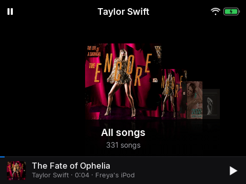

# Developing

## Layout

| Path | What |
|---|---|
| `java/android/` | the player app (Java, Android 4.2): `Engine` (state, sync, playback), `UiView` (all drawing and keys), `HaClient`, `Voice`, `Help*` |
| `java/src/` | the Sendspin client, TLS-free crypto, JSON |
| `java/android/native/` | ARM helpers (zig): Find My radio, Wi-Fi control, the Bluetooth shim, the speech engine (`stt/`) |
| `custom_components/y1_player/` | the Home Assistant integration |
| `deploy/` | server manifests, music-sync, `y1_setup.py`, Help stub generator |
| `provision/` | `y1.py` and the release bundle packager |
| `rom/` | boot scripts, time zone data, Bluetooth shim installer |
| `docs/` | this documentation; `guide/` is the user guide and the Help video script |

## Build and test

```
python3 provision/y1.py doctor      # tools check
python3 provision/y1.py build       # helpers + APK (JDK 17, SDK android-17 and build-tools 34.0.0, zig)
cd java/android && sh test/run.sh   # unit tests (bedtime, hold, crypto)
adb -d install -r java/build/sendspin-y1.apk
```

CI (`.github/workflows/build.yml`) builds the bundle, runs the tests and, on a `v*` tag, releases it.
`validate.yml` runs hassfest and the HACS check. `image.yml` builds and publishes the music-sync container image to GHCR
(from `main` and tags; pull requests only build it).

**Keeping dependencies patched:** `renovate.json` (install the [Renovate GitHub app](https://github.com/apps/renovate) on
the repository) tracks the GitHub Actions (pinned by commit), the Music Assistant and nginx image tags in `deploy/*.yaml`, our
own image's digest, the whisper.cpp tag and commit (moved together), the zig version in `build.yml`, the pinned
flashing-tool Python packages, the Solar ROM release and Conscrypt. When Renovate moves the Solar release,
`.github/workflows/pin-hashes.yml` fills in its sha256 on the pull request (GitHub publishes it per asset). Nothing is
merged automatically for whisper.cpp, Music Assistant, or the flashing tool's packages: each needs a test on a real unit.

**Conscrypt is frozen at 2.5.3**, the last release that runs on Android 4.2 (2.6.0 and later need Android 5), so Renovate is told
not to propose newer ones. It is fetched from Maven Central by `java/android/libs/fetch.sh` (pinned by sha256) instead of being
committed. That makes it an end-of-line TLS library: it talks only to Home Assistant, Music Assistant and Nabu Casa, but
any CVE fixed after 2.5.3 is not fixed here.

## Driving the app from a computer

The app listens for a root-only broadcast (signature permission) that presses keys inside it, which is how everything is
tested and how the screenshots are taken:

```
adb -d shell "su -c 'am broadcast -a me.cns.ab.KEY --ei code 20'"
```

Codes: the Android key codes (UP 19, DOWN 20, CENTER 23, BACK 4, MENU 82, PLAY/PAUSE 85) plus test hooks:

| Code | Does |
|---|---|
| 994 | put the buttons on hold now |
| 995 | dark theme on or off |
| 996 | lock-screen preview |
| 997 | Now Playing preview of the highlighted row |
| 990 | recognise `/sdcard/voice-test.pcm` (16 kHz mono s16le) as if spoken |
| 992 / 993 | behave as if away from home Wi-Fi / a pretend GPS fix |
| 989 / 988 | screenshot mode on / off: no Home Assistant sync, no minutes counted, no unlock lines |

A real press of the middle button: `sendevent /dev/input/event0 1 232 1` then `... 1 232 0`. Injected keys do not wake the
screen or count as activity: wake with `input keyevent 26` and `svc power stayon true` while testing.
Logs: `adb -d logcat -s ab` (and `FMSHIM` for the Bluetooth shim). MediaTek resets its log filter when adbd restarts; the boot
script sets it back.

## Screenshots and the guide



`docs/screenshots/capture.py` takes every screenshot, silently, and `docs/guide/build.py` links them into the chapters and
writes `SCRIPT.md`. The repo skill `.claude/skills/y1-docs` describes the whole routine. Read its safety notes first:
the capture plays music (at volume 0), refuses to run unless every output is at 0, and a wrong row count on a book page can
press *Remove download*.

## Things that cost time

`docs/NOTES.md` is the build log with the traps: MediaTek's second CPU core (use one thread), the Bluetooth stack's
permission quirk, Android 4.2 TLS, why the Bluetooth beacon never sends LE Set Advertising Parameters, and more.
