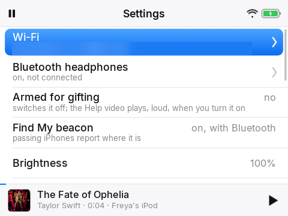

# Home Assistant: the Y1 Player integration

The player appears in Home Assistant as one device with its own sensors, controls and settings. It holds no Home
Assistant token: it pairs with the integration by public key and talks to it only through sealed messages.

## Install

1. Copy `custom_components/y1_player` into your Home Assistant `config/custom_components/`, or add this repository to HACS as
   a custom repository (category *Integration*). Restart Home Assistant. (Changes to the integration's code need a full
   restart, not a reload.)
2. Pair the player, either way:
   - `python3 deploy/y1_setup.py pair` (the player on USB; it reads the player's key, adds it to the integration, links
     helpers and sets starting values from `deploy/secrets/bedtime/device.json`, then pushes `ha.json` to the player), or
   - by hand: *Settings > Devices & services > Add integration > Y1 Player*, name it and paste the **player key** shown on
     the player's *Status* screen. Then run `python3 deploy/y1_setup.py push` to give the player the webhook and key.
3. The grown-up code: `python3 deploy/y1_setup.py secret` once, then `op VAULT` to put it in 1Password (a rolling 5-digit
   code), `check` to compare. See *Bedtime* below.

`deploy/y1_setup.py` needs an admin token for your Home Assistant (`ha_admin_token_file` in `device.json`, or `HA_TOKEN`).
The integration's `pairing_info` service is admin-only; it returns the webhook id, cloudhook URL and the integration's public
key for a given player key.

## What the device page has

| Kind | Entities |
|---|---|
| Sensors | Battery, Now playing (with artist), Listen on, Bedtime minutes left, Find My beacon status, Wi-Fi network, Last seen, Last GPS fix, Bedtime unlocked until |
| Binary sensors | Charging, Playing, Bedtime locked, Buttons on hold, Armed for gifting |
| Location | `device_tracker.<name>`: home Wi-Fi always means home; away from it, a GPS fix less than 6 hours old is shown, otherwise not home |
| Buttons | **Arm for gifting** (see *Gifting*), **Find it**: the player rings loudly for a minute (it checks in about every 30 s on Wi-Fi, so within a minute or so; longer with the screen off or after failed syncs) |
| Text settings | Owner name, Device name, If found contact (lines separated by `\|`), Home Wi-Fi (comma separated), Speakers counted elsewhere |
| Number settings | Volume limit (the player's own menu offers 50 to 100%, Home Assistant 10 to 100%), Bedtime allowance, Bedtime minutes used |
| Time settings | Bedtime starts, Bedtime ends |
| Choice settings | Hold after, Unlock speed, Wheel click, Click loudness |
| Switches | Wheel reversed, Find My beacon, Speaker always on, Keep everything offline, Voice on the iPod only |
| Event | `y1_player_unlocked` when the grown-up code is used (also notifies, see options) |

Settings work both ways: change one here or on the player and the other has it within about 30 seconds; the newest change
wins. The reported sensors (battery, now playing, bedtime, Wi-Fi and so on) become unavailable if the player has not checked in for 10 minutes; *Last seen*, *Last GPS fix*, *Bedtime unlocked until*, the location, the *Find it* button and every setting stay available and editable.

## Options (the integration's *Configure*)

- **Link the bedtime controls** to your own `input_datetime` (start, end) and `input_number` (allowance, minutes used)
  helpers, so other automations, such as a bedroom speaker's, share the same budget. Unlinked, the integration keeps its own
  values and resets its counter when the window opens. A linked counter is reset by whatever you already use.
- **Notify service** (e.g. `notify.mobile_app_phone`): told when the grown-up code is used. If the call fails a persistent
  notification is raised instead.
- **Speech-to-text entity** for voice search when the player is on Wi-Fi (default Home Assistant Cloud).

## Bedtime

A listening allowance inside a night window, counted on the player (also offline) and added to the shared counter with a
sequence number, so a resent message is never counted twice. When it is used up the player fades out and locks (a
night-sky screen that takes only the grown-up code and Wi-Fi). The grown-up code (TOTP, 5 digits, each used once, accepted for
90 to 120 s) does two separate things. Typed on the goodnight screen it lifts the limit for 8 hours and tells you (the
`y1_player_unlocked` event, payload `{device, until}`, and the notify service). Typed in Settings it only opens the protected
settings for 10 minutes (ending sooner if the screen goes off); it does not lift the limit and sends nothing to Home Assistant.
Five wrong codes in a row lock code entry for a minute, doubling each time.

## Gifting

The *Armed for gifting* row is in the player's Settings too (it asks for the grown-up code):

The **Arm for gifting** button (or the *Arm for gifting* row in the player's Settings, which asks for the grown-up code) arms
the player and **switches it off** at its next check-in (a few seconds on Wi-Fi). The next time it is turned on, it plays the
Help video at full volume from chapter 1 (a few seconds after it has started up; never through headphones, bedtime does not
stop it), then disarms itself: a freshly set-up iPod can be handed over and explains itself the first time it is switched on.
The *Armed for gifting* binary sensor shows whether it is armed. It will not arm without a Help video on the player (it says
so on screen and stays on). Pressing the button again while armed switches it off again; if the player is still on and armed, the
row in Settings cancels it.

## Security model

- Keys: the player makes an X25519 key pair on first run (never leaves it); the integration makes one per paired player. A
  shared secret per direction comes from HKDF; every message is ChaCha20-Poly1305 with a counter that must rise, so a
  captured message cannot be replayed, and a stale reply does not match its request.
- The webhook is public by nature (and reachable through a Nabu Casa cloudhook): an unknown or tampered body gets a bare
  400, nothing is learned, voice requests are capped (30 s of audio, 6 a minute) and only from a paired player.
- A paired player can: report its sensors and location, add played minutes (once per sequence number), read and change its
  own settings (device timestamps are bounded, values validated), and ask for speech-to-text. It cannot call any Home
  Assistant service. Removing the integration entry revokes it and removes its cloudhook.
- adb on the player is locked to the maintainer's key when one is installed: see `docs/PROVISIONING.md`.
