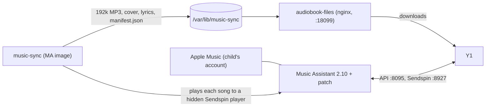

# The server side: Music Assistant, music-sync, the file server

The player needs a [Music Assistant](https://music-assistant.io/) (MA) server on the home network, the child's Apple Music
added to it, and two small services next to it. This is tested on k3s (the manifests are Kubernetes); the same containers
should run under Docker with the same environment and mounts (untested).



## 0. Before you start

- The namespace `music-assistant` (where Music Assistant runs). If yours is elsewhere, change `namespace:` in both
  manifests.
- **music-sync, the file server and Music Assistant must run on the same node**: all use host networking, and the recordings
  and the file server share a `hostPath`. Set `nodeSelector` (commented in both manifests) to that node, or set `MA_HOST`
  in `music-sync.yaml` to Music Assistant's address.
- A PersistentVolumeClaim named `audiobooks` in that namespace holding the folder Music Assistant reads audiobooks from
  (`audiobook-files.yaml` mounts it read-only). If you have no audiobooks, replace that volume with `emptyDir: {}`.

## 1. Music Assistant

- Add the child's Apple Music as its **own provider instance** (Music Assistant, Settings > Providers). Note its instance id
  (`apple_music--XXXXXXXX`, shown against the provider; also in the URL of its settings page). Edit `LIBRARY_PROVIDER`,
  `OWNER_NAME` and `DEVICE_NAME` in `music-sync.yaml`: left as the placeholders, music-sync looks for a playlist called
  `FREYAS` and finds nothing.
- Create a **Music Assistant user for the child** (role *user*) restricted to their own provider and to the speakers they
  may use, and mint a long-lived token for it. MA picks the streaming account by the requesting user's provider filter, so
  the child's token streams from the child's account, never an adult's. Keep it in `deploy/secrets/ma_token`.
- An **admin token** for music-sync goes in the `music-sync-token` secret (key `token`); the child's token goes in the same
  secret as `play_token`.
- Optional patch: `deploy/music-assistant-patch/` makes "remove from library" work for Apple Music (stock MA cannot delete
  from Apple's library). It is a `sitecustomize.py` mounted into the stock image; see that folder's README. Without it,
  *Remove from my iPod* may leave the song in the child's Apple Music library, so it would come back on the next sync.

## 2. music-sync (`deploy/music-sync.yaml`, `deploy/music-sync/`)

Records the library to MP3 in real time (Apple Music can only be decrypted by MA): each song is played to one of up to 8 hidden
Sendspin players (`WORKERS`), captured and encoded, with cover art and lyrics (LRCLIB, then Genius), and a `manifest.json`
the player syncs from. It adopts clean versions of explicit songs, drops songs removed from the library, and learns how many
parallel streams Apple allows. Settings are environment variables: `LIBRARY_PROVIDER` (the instance id above),
`PLAY_TOKEN_FILE`, `OWNER_NAME`, `DEVICE_NAME` (the names shown on the player), `WORKERS`, `BITRATE`, `INTERVAL`, `TZ`.
It runs from its own image, `ghcr.io/chrisns/sendspin-y1-music-sync` (`deploy/music-sync/Dockerfile`: the Music Assistant
server image plus the two scripts), built and published by `.github/workflows/image.yml`. The first time, make the package
public on GitHub (*Packages > sendspin-y1-music-sync > Package settings > Change visibility*) or give the cluster a pull
secret; GitHub does not allow that step through the API. Put the secret in place from files (not the command line), `kubectl apply`:

```
mkdir -p deploy/secrets && chmod 700 deploy/secrets        # gitignored: keep tokens here
# save the admin token as deploy/secrets/ma_admin_token and the child's as deploy/secrets/ma_token (chmod 600)
kubectl -n music-assistant create secret generic music-sync-token \
  --from-file=token=deploy/secrets/ma_admin_token --from-file=play_token=deploy/secrets/ma_token
kubectl apply -f deploy/music-sync.yaml
```

The first full sync is roughly real time (a library of over a thousand songs takes many hours).

## 3. The file server (`deploy/audiobook-files.yaml`)

A read-only nginx on port 18099 serving the audiobook volume and music-sync's output, so the player can download whole books
and songs. **The secret path prefix is the access control** (LAN only): replace `CHANGE-ME-RANDOM-PREFIX` in both `location`
blocks with `openssl rand -hex 12`, and give the player the same string (`gw_prefix`). Do not commit that edit (the prefix
is the access control): apply a substituted copy instead.

```
P=$(openssl rand -hex 12); printf %s "$P" > deploy/secrets/gw_prefix; chmod 600 deploy/secrets/gw_prefix
sed "s/CHANGE-ME-RANDOM-PREFIX/$P/g" deploy/audiobook-files.yaml | kubectl apply -f -
kubectl -n music-assistant rollout restart deploy/audiobook-files     # nginx does not reload its config by itself
```

## 4. The player's connection

Once connected, the Status screen shows it, and how much music has arrived:


`python3 provision/y1.py provision` asks for the Music Assistant address, the child's token and the file-server prefix
and sets them in the app; or `MA_HOST=<address> deploy/deploy_y1.sh` with `deploy/secrets/ma_token` and
`deploy/secrets/gw_prefix` (it builds the helpers and the app first, which needs zig; on macOS it also needs `timeout`
from coreutils unless you let it fall back, which it does).
Ports: Music Assistant API 8095, Sendspin 8927, file server 18099. Audiobooks come from MA's audiobook library, which
needs the books added there.

## Rotating the file-server prefix

Pick a new prefix, change both `location` blocks, apply and restart nginx, then re-provision the player (the app's
`gw_prefix`). The old prefix then answers 404.
