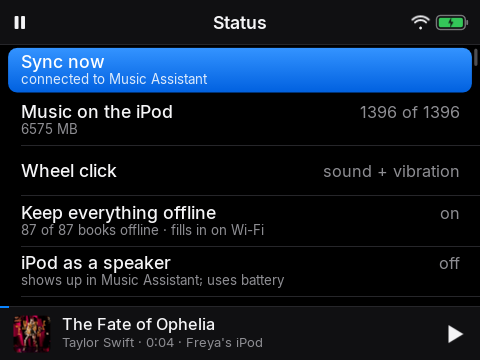
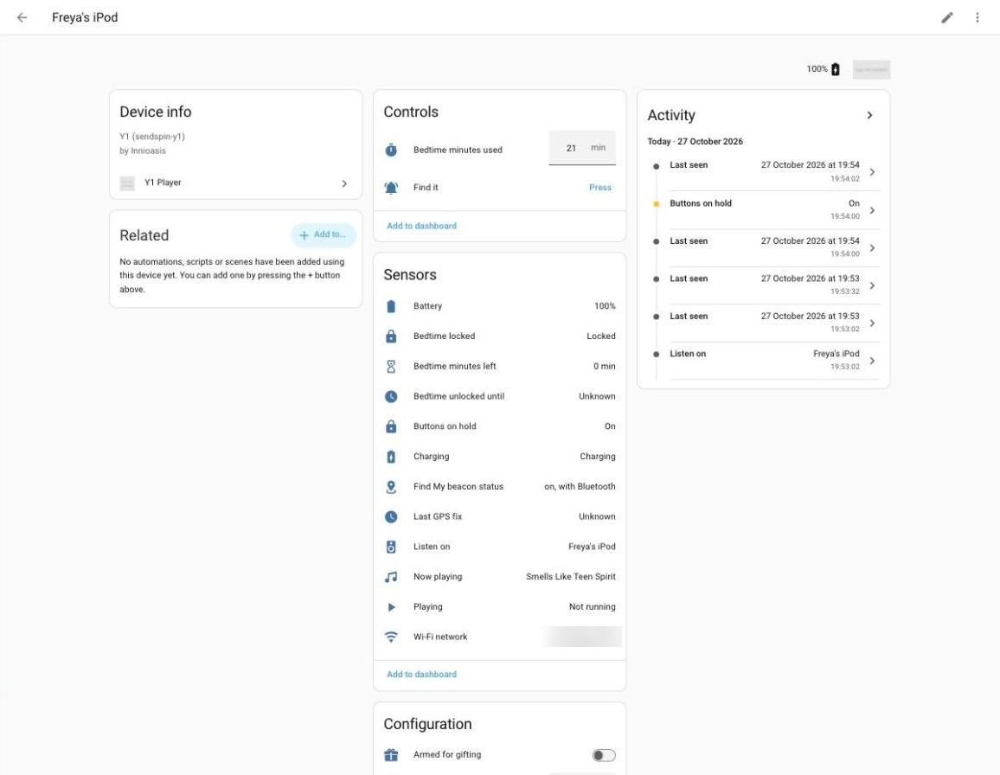

# Troubleshooting

Symptom, likely cause, what to do. The player's **Status** screen is the first place to look: it says whether it is connected
to Music Assistant and how much music is still to sync.

## On the player

| Symptom | Cause | What to do |
|---|---|---|
| Buttons do nothing | The hold: after a quiet spell (Settings, *Hold after*) the buttons are ignored | Press one button three times, quickly (the lock screen says so) |
| The screen says "Goodnight" and only offers *Grown-up code* and *Wi-Fi* | Tonight's allowance is used up (or it is in the bedtime window with none left) | A grown-up types the 5-digit code from 1Password. Allowance and window are on the Home Assistant device page |
| "Offline" on Status, no music from speakers | No Wi-Fi, or Music Assistant is not reachable | Settings > Wi-Fi. Joining a network needs no code. Check the Music Assistant address was set at provisioning |
| New songs do not arrive | music-sync is still recording, or has stopped | `kubectl -n music-assistant logs deploy/music-sync`. The first sync takes many hours. Songs Apple has no copy of are listed as unavailable |
| Headphones connect but there is no sound after restarting Bluetooth | A known quirk of this chip: restarting Bluetooth by hand breaks A2DP until a reboot | Reboot the player (Power menu, *Restart*) |
| Voice search says "Voice search needs Wi-Fi" or "Voice search isn’t set up on this iPod" | No local speech model installed, and either no Wi-Fi or *Voice on the iPod only* is on | Install the model (`java/android/native/stt/build.sh install`), or get on Wi-Fi with that switch off |
| Voice search takes minutes | An old build ran whisper on two threads; the Y1 keeps one CPU core off | Update the app (one thread, a short window); a clip should take 3 to 5 s |
| The Help row says "The Help video isn’t on this iPod yet" | `/sdcard/Help/help.mp4` is missing | `python3 deploy/help/make_stub.py push`, or copy your video and `help.json` there |
| *Arm for gifting* does nothing (the player says there is no Help video) | There is no Help video on the player | Put the video there first |
| The time is wrong, or bedtime starts at the wrong moment | The clock has no battery-backed time; it sets itself from Wi-Fi time, the sealed Home Assistant reply, or GPS | Join Wi-Fi once, or let it sync with Home Assistant |

## Home Assistant

| Symptom | Cause | What to do |
|---|---|---|
| Entities are unavailable | The player has not checked in for 10 minutes (off, out of range, or no Wi-Fi) | Settings stay editable and apply when it is back. Check *Last seen* on the device page |
| Status says "Home Assistant: Home Assistant is not answering for this player (starting up, or not paired?)" | Home Assistant is restarting, or the integration entry was deleted (this is what it shows, for as long as it lasts, after a deletion) | Wait a minute; otherwise run `deploy/y1_setup.py pair` again. It retries by itself (30 s, then longer) |
| Status says "removed from Home Assistant: register it again" | Home Assistant refused the player's key five times in a row (a different key, e.g. after a reinstall) | `deploy/y1_setup.py pair` |
| Changes to the integration's code have no effect | Home Assistant keeps the old module until a restart | Restart Home Assistant (a reload is not enough) |
| The player ignores a setting I changed | It was changed on the player later (newest wins) | Change it again; both sides agree within about 30 seconds |
| *Find it* does nothing | The player is asleep without Wi-Fi, or the press is more than 10 minutes old when it next checks in | It rings on the next check-in if the press is recent; try again with it on Wi-Fi |
| Bedtime minutes are doubled or missing | A linked helper was unavailable, or another automation also adds minutes | Link the controls in the integration's options and let only one thing add minutes |

## Provisioning and flashing

| Symptom | Cause | What to do |
|---|---|---|
| `adb` shows "unauthorized" or no device | adb on the player is locked to the maintainer's key when one is installed | See *Security of adb* in [PROVISIONING.md](PROVISIONING.md). A freshly provisioned player has no key installed, so it is open |
| `adb` lists nothing after a reboot or when video starts | The USB link blips while the player stays up | `adb kill-server`, then `adb devices` |
| The first boot after flashing crashes (a Solar launcher error) | Solar's own libraries are missing from `/system/lib` (upstream issue 83) | `provision/y1.py provision` copies them out of Solar's APK for you |
| Flashing waits for the device for ever | The Y1 must be switched **off** when you start, then plugged in; on macOS install libusb (`brew install libusb`) | Unplug, power off, run `flash` again, plug in |
| `provision` stops before it changes anything | It waits for the first boot to finish and checks the tools first | Run `y1.py doctor`, then again once the Y1 has booted |
| An app update fails with a signature error | Release bundles are signed with a key made for that release | `adb uninstall me.cns.sendspin.android` then install, or build from source with your own key |

## Server side

| Symptom | Cause | What to do |
|---|---|---|
| The file server answers 404 | Wrong path prefix (the prefix is the access control) | Use the same random string in the nginx config and the player's `gw_prefix`; restart nginx after changing the config map |
| Everything is recorded but the player will not download | The player's prefix or address is wrong | Provision again: `provision/y1.py provision` |
| Recording stops, "too many streams" | Apple limits concurrent streams | music-sync learns the limit; it needs a few minutes to settle. Lower `WORKERS` if it keeps tripping |
| A removed song comes back | The Apple Music delete did not happen (stock Music Assistant cannot do it) | Mount the patch in `deploy/music-assistant-patch/` |

If something here is wrong or missing, the build log in [NOTES.md](NOTES.md) has the detail behind most of these.
