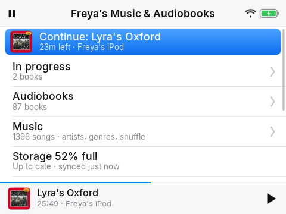

# 1. Intro

*Welcome: what the iPod is and how it works*

## Narration

> Hello! This is your very own iPod.
>
> It plays your music and your audiobooks, and it keeps them on the iPod, so they play anywhere, even with no Wi-Fi.
>
> In this video I will show you how everything works. You can watch it all the way through, or pick a part from the Help list at the bottom of the menu, any time you like.

## On screen

-  <!-- shot:menu -->

## For grown-ups

The Y1 is a click-wheel player running our own app as its home screen. Music is recorded from the family's Apple Music library by `music-sync` and copied to the player; audiobooks come from Music Assistant. Everything plays from the player's own storage. The last row of the menu, **Help**, plays this video.

This guide is also the script for that video: the *Narration* blocks are spoken, the *On screen* lists are the shots, and *For grown-ups* is documentation only.
