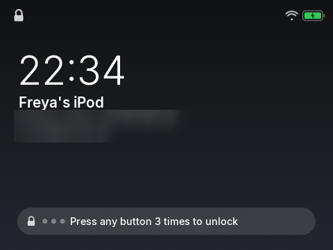

# 2. Finding your way around

*The wheel, the buttons, the lock*

## Narration

> Turn the wheel to move up and down the list. Press the middle button to choose.
>
> The Menu button takes you back.
>
> If you leave the iPod alone for a minute, the buttons go to sleep so nothing happens in your pocket. To wake them, press the same button three times, quickly.

## On screen

-  <!-- shot:menu -->
-  <!-- shot:hold -->

## For grown-ups

- **Wheel**: moves the highlight (reversible in Status, *Wheel direction*, or the *Wheel reversed* switch in Home Assistant). Click sound and vibration are in Settings.
- **Middle**: choose. **Menu**: back; hold it for the power menu (Hold, Listen on, Sleep, Power off, Restart).
- **Play/Pause**, **Next**, **Previous**: as on any player; holding Next or Previous skips 30 seconds in a book; holding Play opens Now Playing.
- **Hold**: after a quiet spell (default 1 minute, Settings, *Hold after*) the buttons are ignored; three presses of one button within a second unlock them. Wheel turns never count, so a wheel rubbing in a pocket cannot unlock it.
