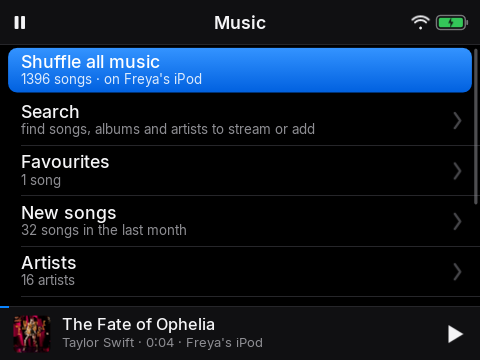
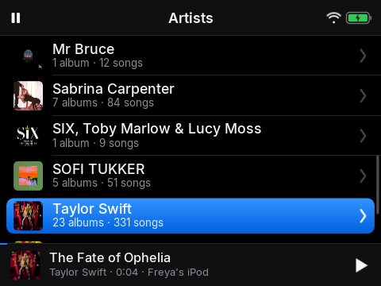
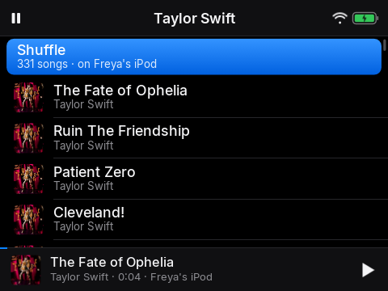
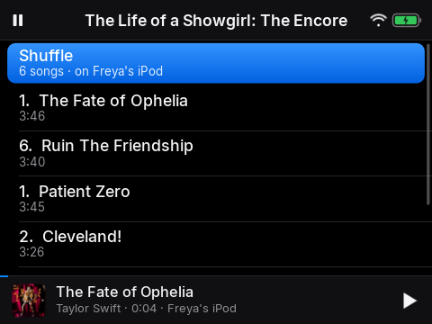

# 3. Music

*Your songs, and how to play them*

## Narration

> Choose Music to find your songs. You can look by artist, by album or by kind of music, or choose New songs to see what has just arrived.
>
> Pick an artist, and you will see a row of their albums. Pick an album to see its songs. Choose All songs to see everything by that artist.
>
> You can shuffle too. Shuffle all plays everything in a surprise order, and on an artist or an album it mixes up just theirs.
>
> While a song plays, the words scroll along in time, if the song has them.

## On screen

-  <!-- shot:music -->
-  <!-- shot:artists -->
-  <!-- shot:artist -->
-  <!-- shot:artist-songs -->
-  <!-- shot:album-tracks -->
-  <!-- shot:now-playing -->

## For grown-ups

Songs are recorded at 192 kbit/s MP3 with cover art and lyrics (LRCLIB, then Genius). Explicit songs are replaced with clean versions where Apple has them; explicit search results are hidden. The list of songs is the child's Apple Music library, kept in step automatically.
