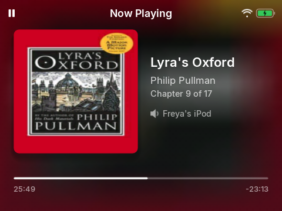

# 3. Music

*Your songs, and how to play them*

## Narration

> Choose Music to find your songs. You can look by artist, by album or by kind of music, or choose New songs to see what has just arrived.
>
> Choose Shuffle all and the iPod plays everything in a surprise order.
>
> While a song plays, the words scroll along in time, if the song has them.

## On screen

- {{shot:music-home}}
-  <!-- shot:now-playing -->
- {{shot:lyrics}}

## For grown-ups

Songs are recorded at 192 kbit/s MP3 with cover art and lyrics (LRCLIB, then Genius). Explicit songs are replaced with clean versions where Apple has them; explicit search results are hidden. The list of songs is the child's Apple Music library, kept in step automatically.
