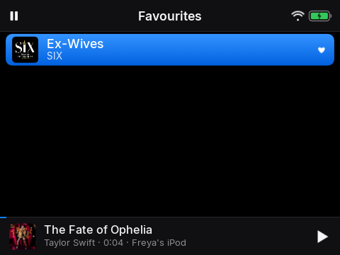

# 4. Favourites

*Keep the songs you love close*

## Narration

> When you hear a song you love, hold down the middle button on it. A little heart appears.
>
> Your hearts all live together in Favourites, at the top of Music. Hold the middle button again to take a heart away.

## On screen

-  <!-- shot:favourites -->

## For grown-ups

Hold centre on a song row or in Now Playing toggles the favourite. Favourites are a playlist in Music Assistant named `<device name>: favourites`, so they follow the child across speakers.
