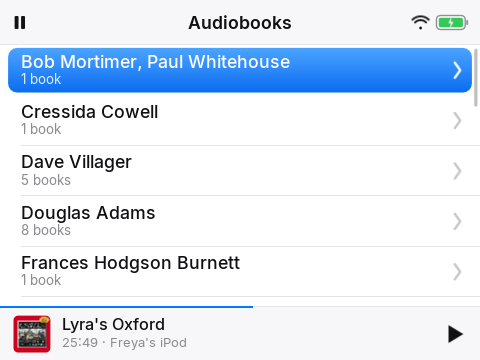
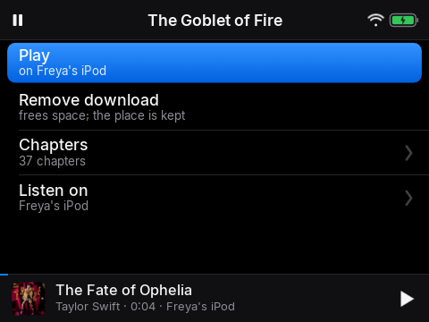

# 5. Audiobooks

*Pick up exactly where you stopped*

## Narration

> Your audiobooks are in Audiobooks. Choose one to start listening.
>
> The iPod remembers where you stopped, even if you switch it off, and it will carry on from the same place. If a book has chapters, you can choose one from the Chapters list.

## On screen

-  <!-- shot:authors -->
-  <!-- shot:book-page -->

## For grown-ups

All books are downloaded to the SD card when there is Wi-Fi (Settings, *Keep everything offline*). Position syncs both ways with Music Assistant, so a book started on a speaker continues on the player and the other way round. Holding Next or Previous skips 30 seconds.
