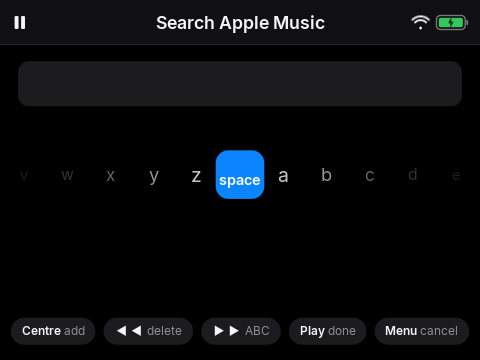
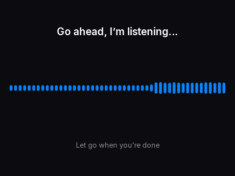
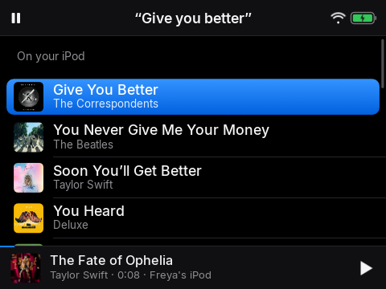

# 6. Searching

*Type a name, or just say it*

## Narration

> To find something new, choose Search. Turn the wheel to find a letter, and press the middle button to add it. When you have spelled it, press Play.
>
> Or do it the easy way. Hold the middle button anywhere except on a song, and say what you want, like, give you better. Let go, and the iPod finds it.
>
> Songs already on your iPod come first. Then, if you have Wi-Fi, you will see more songs to stream. Choose one to play it, or add it to your library so it stays on your iPod for ever.

## On screen

-  <!-- shot:search -->
-  <!-- shot:voice-listening -->
-  <!-- shot:voice-thinking -->
-  <!-- shot:voice-results -->

## For grown-ups

While you hold, the iPod pauses what is playing, shows a live waveform and *Go ahead, I'm listening...*; up to 10 seconds are recorded from the built-in microphone. Speech becomes text through Home Assistant's speech-to-text on Wi-Fi (default Home Assistant Cloud) or on the player with whisper.cpp when offline or when *Voice on the iPod only* is on (3 to 5 seconds). Matching on the player is by words in the title, artist and album, tolerant of one wrong letter. *Add to my library* puts the song in the child's Apple Music library; the music server records it and it arrives on the next sync. *Remove from my iPod* also removes it from the library.
