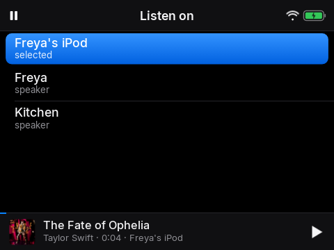
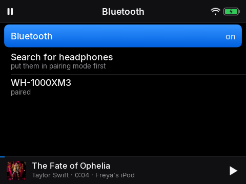

# 7. Listening on speakers and headphones

*Play it in the kitchen, or in your ears*

## Narration

> Choose Listen on to play your music on a speaker in the house, like the one in your room. It carries on from the same place.
>
> For headphones, go to Settings and choose Bluetooth headphones. Put your headphones in pairing mode, choose Search for headphones, and pick them from the list. Turn the volume with the wheel or the buttons on the headphones.

## On screen

-  <!-- shot:listen-on -->
-  <!-- shot:bluetooth -->

## For grown-ups

The buttons on Bluetooth headphones work as on any player: play and pause, next and previous (hold for 30 seconds in a
book), and the volume. They keep working while the iPod's own buttons are on hold. The iPod's own speaker is used when no
headphones are connected.

Playback moves between the player (its own speaker, or Bluetooth headphones) and any Music Assistant speaker, keeping the position. The player can also appear as a Sendspin speaker itself (*iPod as a speaker*). Bluetooth pairing uses the system stack; connecting is done as root because of a permissions quirk on this Android build (see NOTES).
