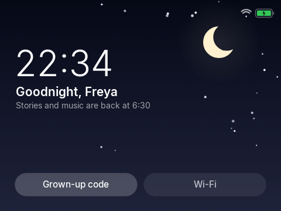
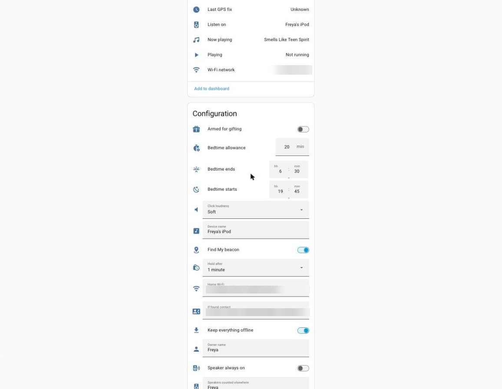

# 8. Bedtime

*Sleep well*

## Narration

> Every night there is a bedtime window, and a little time to listen. When your time is used up, the iPod fades out and says goodnight.
>
> That is not a punishment. It is to help you sleep. If a grown-up says it is fine, they can unlock it for a while with their special code.

## On screen

-  <!-- shot:bedtime-lock -->
-  <!-- shot:ha-device-config -->

## For grown-ups

The allowance, window and counter live in Home Assistant (device page: *Bedtime starts / ends / allowance / minutes used*, optionally linked to existing helpers so a bedroom speaker shares the same budget). Minutes are added with a sequence number so a resend is never counted twice. A grown-up code (5-digit TOTP, one use each, from 1Password) lifts the limit for 8 hours and notifies a parent; it also opens the protected settings for 10 minutes.
