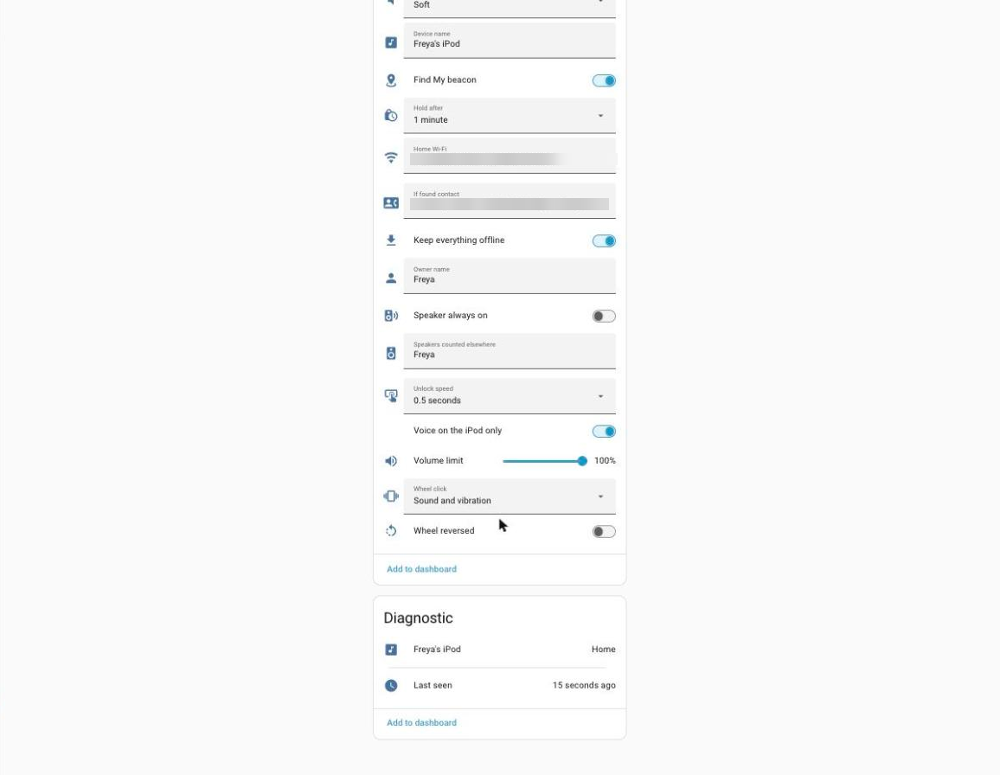

# 10. Settings

*Make it yours*

## Narration

> In Settings you can join Wi-Fi, change how bright the screen is, and choose how the wheel clicks.
>
> Some settings are for grown-ups, and ask for the code. Joining Wi-Fi is fine for anyone, but taking a network away needs a grown-up.

## On screen

-  <!-- shot:menu-more -->
-  <!-- shot:ha-device-config-more -->
- {{shot:wifi}}

## For grown-ups

Everything is also a control on the device page in Home Assistant (name, contact, home Wi-Fi, volume limit, hold, wheel click, Find My, speaker always on, keep offline, voice on the iPod only). Changes made in either place reach the other within about 30 seconds; the newest change wins. Joining Wi-Fi and switching it on need no code; switching it off and forgetting a network do.
