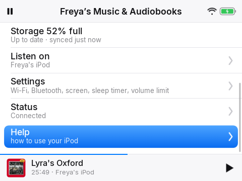
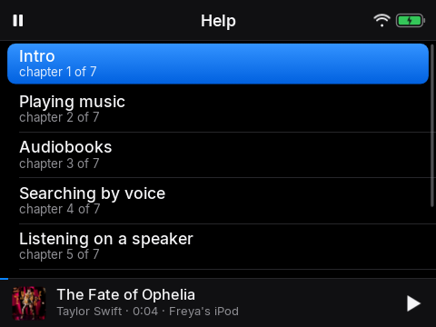

# 11. That is everything

*Have fun*

## Narration

> That is everything! Your music, your books, your favourites, and your voice.
>
> You can watch any part again from the Help list. Now go and enjoy your iPod.

## On screen

-  <!-- shot:menu-more -->
-  <!-- shot:help -->

## For grown-ups

**Giftable setup.** *Armed for gifting* (the Home Assistant switch, or Settings with the grown-up code) switches the player off. The next time it is turned on it plays this video at full volume from the start (through its own speaker, never headphones), then disarms itself, so a freshly set-up iPod can be handed over and explain itself. It will not arm with no Help video on the player.

**Making the video.** The player plays `/sdcard/Help/help.mp4` and reads chapter names and start times from `help.json` beside it. `docs/guide/build.py` writes the spoken script (`SCRIPT.md`) and `help.json` timings from these chapters; `deploy/help/make_stub.py` makes a placeholder video from the same text.
